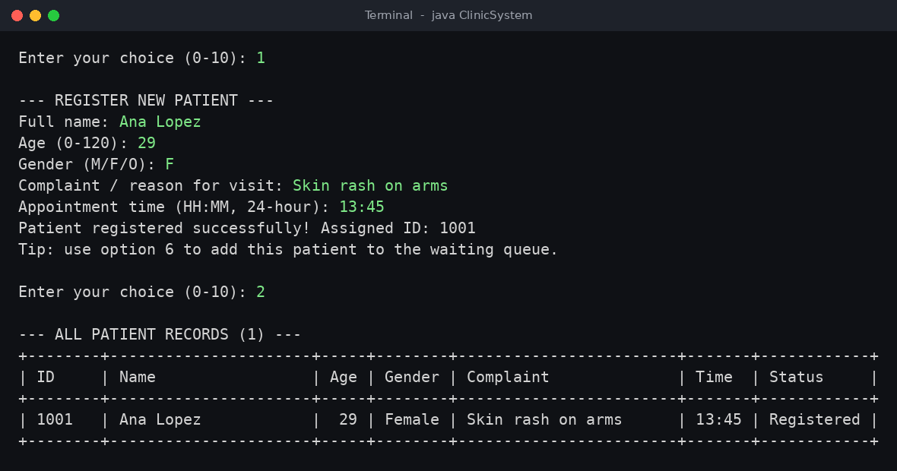
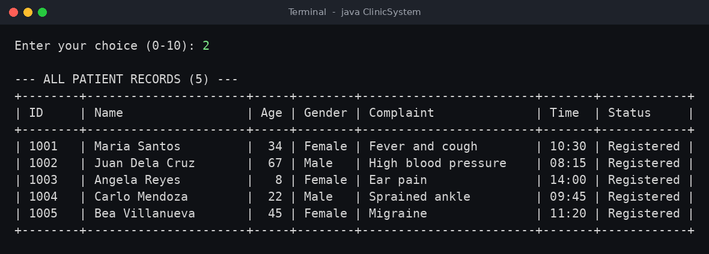
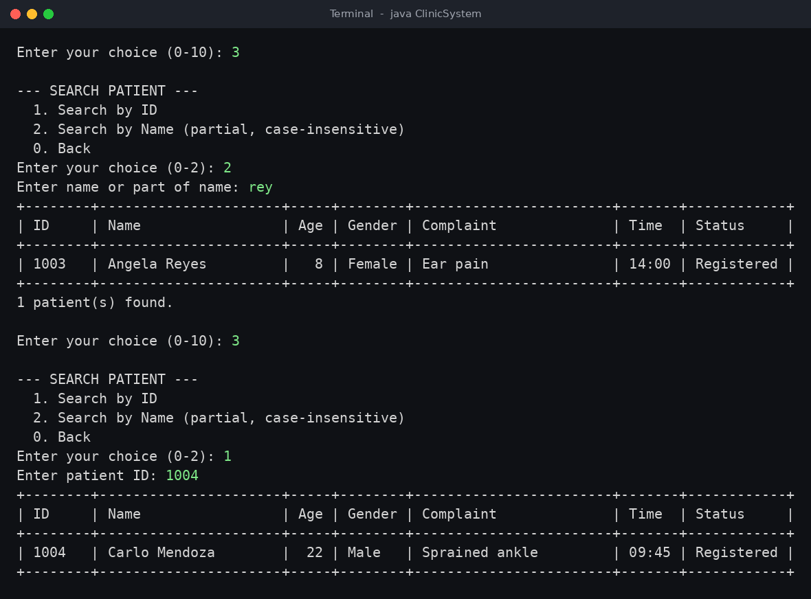
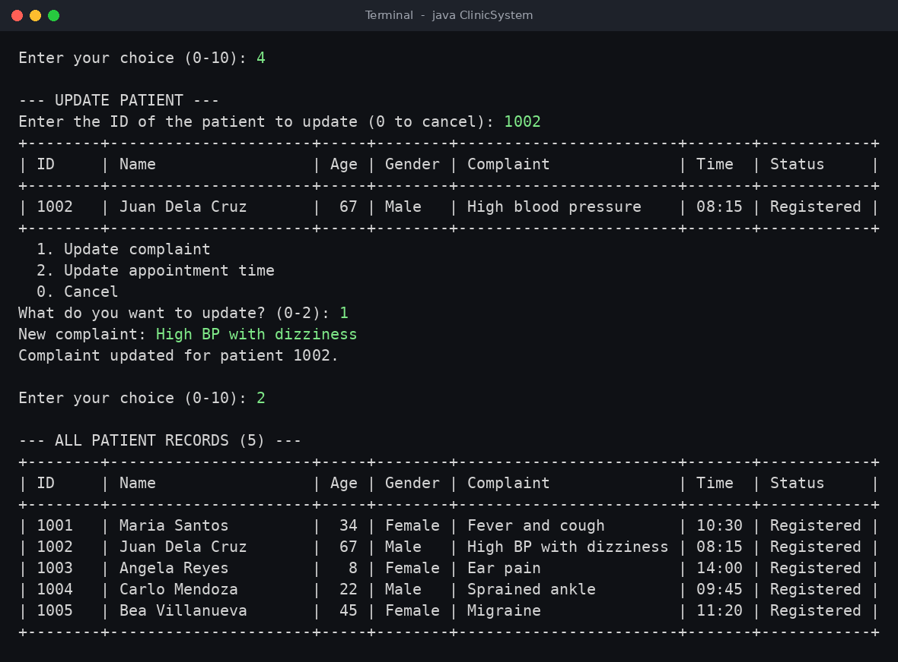
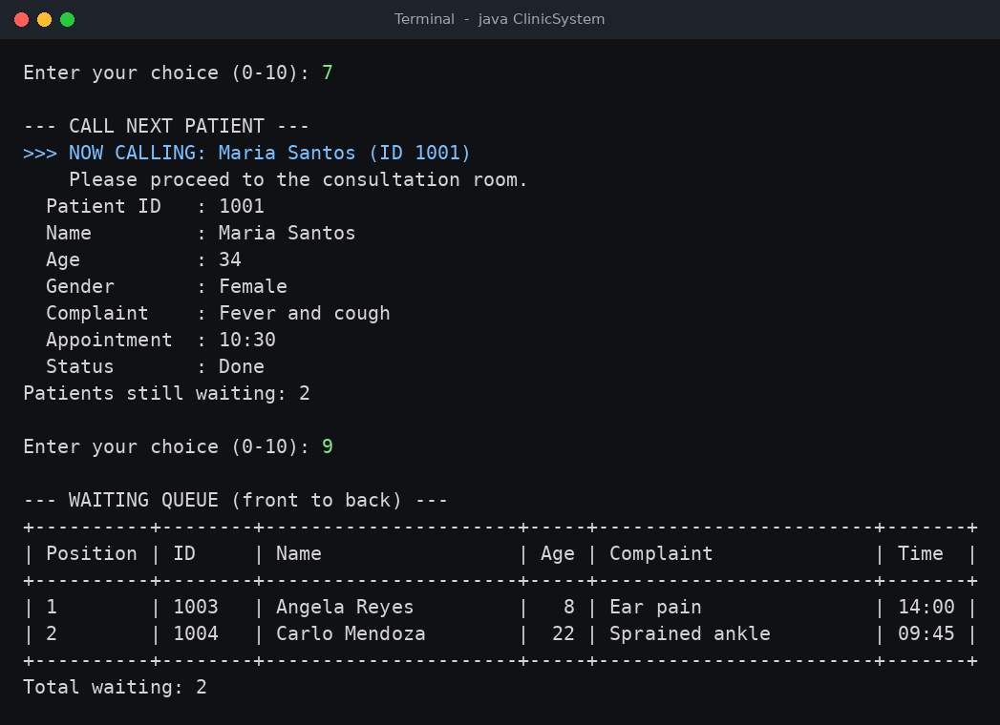
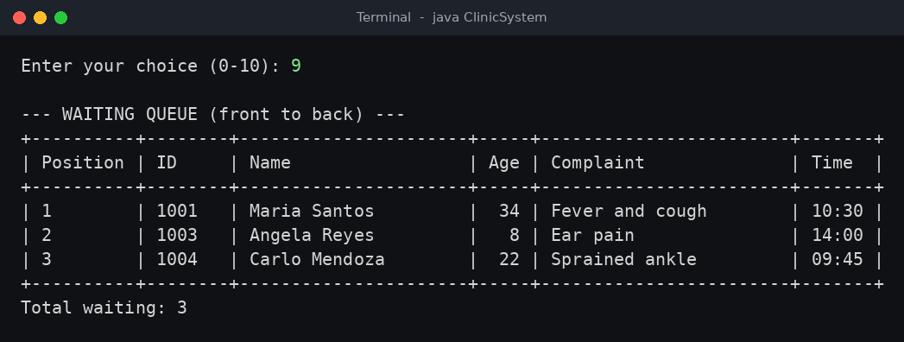
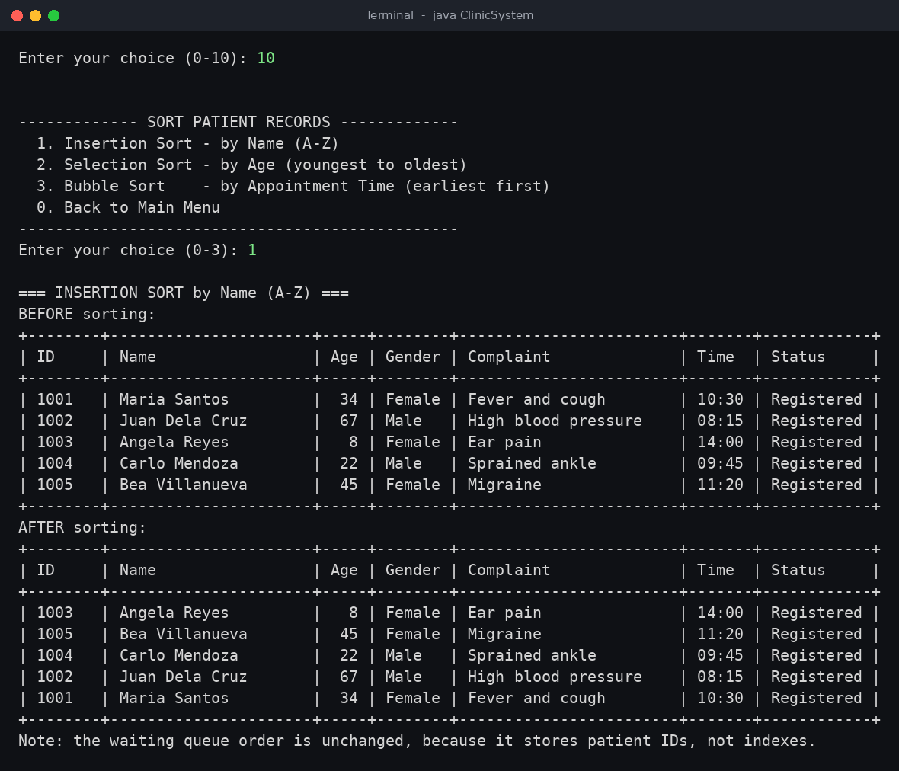
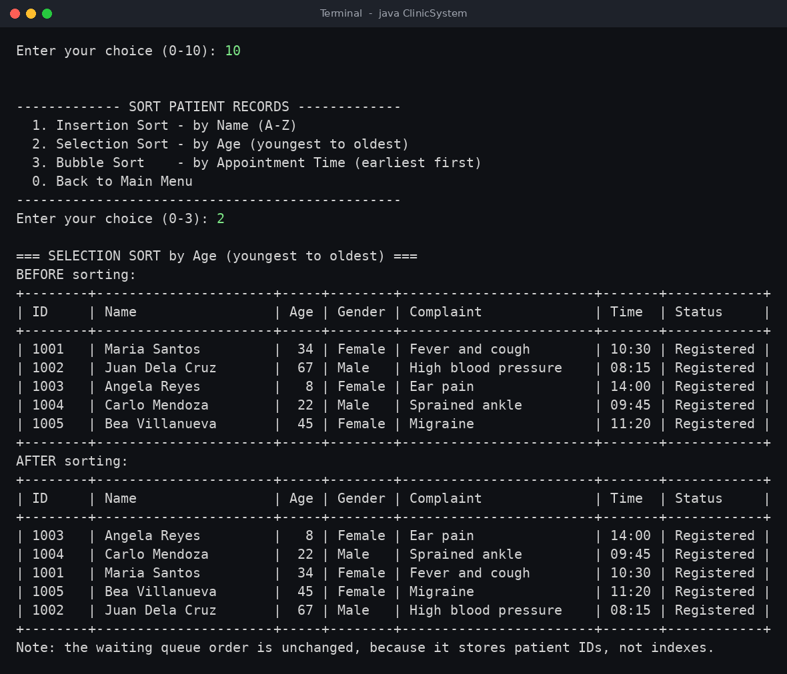
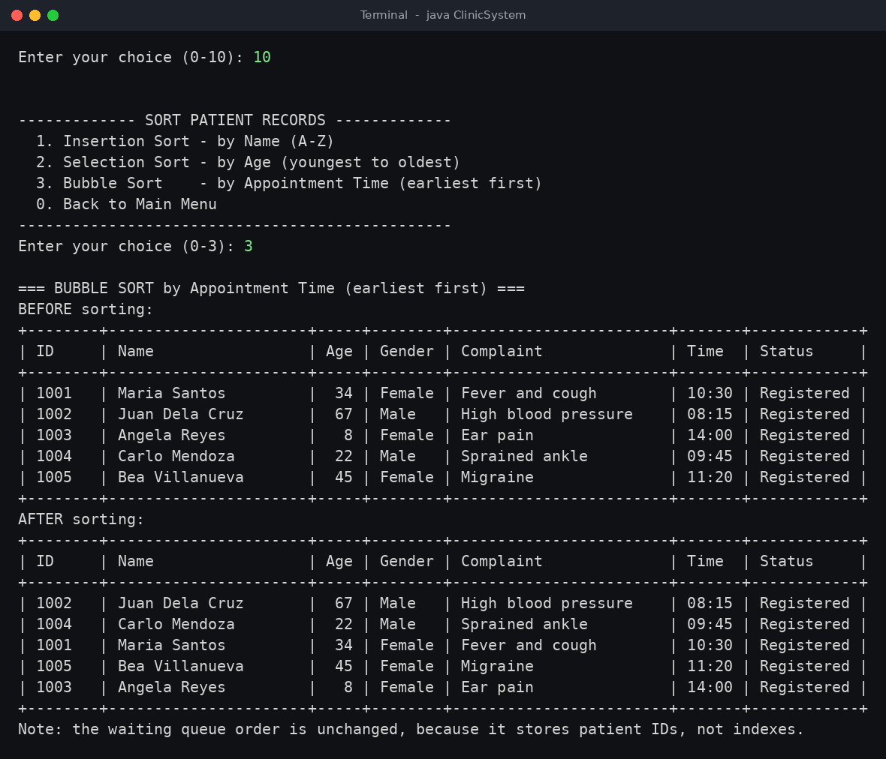
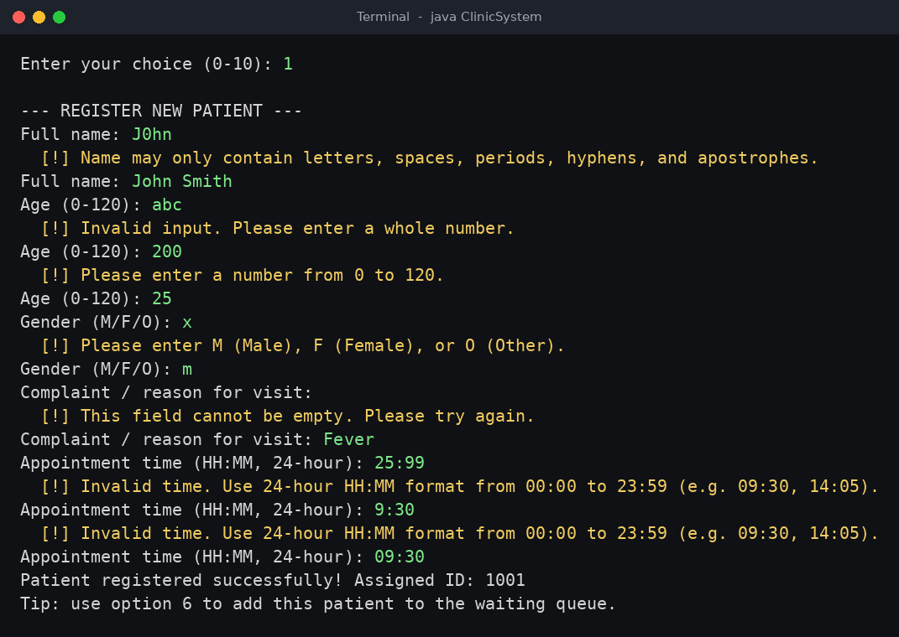

# Clinic Queue and Patient Management System

## Project Description

Small clinics often track patients on paper or in scattered notes. This causes lost records, duplicate entries, unclear waiting order, and long searches for one patient's details.

This console application keeps all patient records in one place and manages the consultation line in first-come, first-served order. Staff can register patients, search and update their records, add them to a waiting queue, and call them one at a time. Records can also be sorted by name, age, or appointment time. All input is validated, so incorrect entries never crash the program.

## Objectives

- Store and manage patient records using parallel `ArrayList`s.
- Provide full record management: register, display, search, update, and remove.
- Manage the consultation line with a FIFO queue (`Queue` backed by `LinkedList`).
- Implement sorting algorithms by hand and keep every list in sync while sorting.
- Validate all user input so the program never crashes on bad entries.
- Follow a procedural design: one class with static methods and no custom objects.

## Use Cases and Features

| # | Feature | Description |
|---|---------|-------------|
| 1 | Register Patient | Enter name, age, gender, complaint, and appointment time (24-hour `HH:MM`). A unique ID is generated automatically, starting at 1001. |
| 2 | Display All Patients | Shows every patient in an aligned table. |
| 3 | Search Patient | Search by exact ID, or by partial name (case-insensitive). |
| 4 | Update Patient | Change a patient's complaint or appointment time. |
| 5 | Remove Patient | Deletes a patient after confirmation. If the patient is in the queue, they are removed from it too. |
| 6 | Add Patient to Queue | Adds a registered patient to the back of the queue. Duplicates are rejected, and the status changes to `Waiting`. |
| 7 | Call Next Patient | Removes the front patient from the queue, shows their details, and marks them `Done`. |
| 8 | View Next Patient (Peek) | Shows who is next without removing them from the queue. |
| 9 | Display Waiting Queue | Lists all waiting patients from front to back, with positions. |
| 10 | Sort Patient Records | Sub-menu with Insertion Sort (name), Selection Sort (age), and Bubble Sort (appointment time). Shows the table before and after sorting. |
| 0 | Exit | Closes the program. |

**Other features**

- Optional startup load of 5 sample patients (IDs 1001-1005) for demonstration.
- Input validation for every field:
  - Numbers must be whole and within range.
  - Names may contain only letters, spaces, periods, hyphens, and apostrophes.
  - Gender is accepted as M/F/O.
  - Time must be a valid 24-hour `HH:MM`.
  - Confirmations accept only Y/N.
  - Unknown patient IDs are rejected.
- Patient IDs are never reused, even after a patient is removed.
- Safe exit if the input stream is closed (Ctrl+D / Ctrl+Z).

## Data Structure Explanation

### Parallel ArrayLists (patient records)

The program does not use classes or objects. Instead, each patient field has its own `ArrayList`, and **index `i` in every list belongs to the same patient**.

| List | Type | Stores |
|------|------|--------|
| `patientIds` | `ArrayList<Integer>` | Unique patient ID |
| `patientNames` | `ArrayList<String>` | Full name |
| `patientAges` | `ArrayList<Integer>` | Age |
| `patientGenders` | `ArrayList<String>` | Male / Female / Other |
| `complaints` | `ArrayList<String>` | Reason for visit |
| `appointmentTimes` | `ArrayList<String>` | Time in `HH:MM` |
| `statuses` | `ArrayList<String>` | Registered / Waiting / Done |

To keep the lists aligned, only a few helper methods change their structure:

- `addPatient()` appends to the end of all seven lists.
- `removeRecordAt(index)` removes the same index from all seven lists.
- `swapRecords(i, j)` swaps two positions in all seven lists at once. Every sort uses it, so a patient's data always moves together.
- `findIndexById(id)` does a linear search for a patient's current index. This is needed because sorting changes indexes.

### Queue (consultation line)

`consultationQueue` is a `Queue<Integer>` implemented with `LinkedList`. It works First-In, First-Out (FIFO): the first patient added is the first one called.

| Operation | Menu option | Queue method |
|-----------|-------------|--------------|
| Enqueue | 6. Add Patient to Queue | `offer(id)` |
| Dequeue | 7. Call Next Patient | `poll()` |
| Peek | 8. View Next Patient | `peek()` |
| Display | 9. Display Waiting Queue | for-each loop (does not remove anything) |

**The queue stores patient IDs, not list indexes.** Sorting moves records to new indexes, but an ID never changes. The queue therefore stays correct after any sort, and the matching record is found with `findIndexById()` when needed.

## Sorting Algorithm Explanation

Three hand-written sorting algorithms are implemented (two required, plus one bonus). None use `Collections.sort()` or other built-in sorts.

### 1. Insertion Sort: by Name (A-Z)

- **Purpose:** Arrange patients alphabetically so records are easy to find.
- **How it works:** The list is split into a sorted left part and an unsorted right part. Each record is slid left, swapping with its neighbour, until it reaches its correct place. Names are compared with `compareToIgnoreCase()`.
- **Complexity:** Best O(n), average and worst O(n²), space O(1). It is stable.
- **Why it fits:** A clinic's daily roster is short and usually nearly sorted, which is where insertion sort is fastest.

### 2. Selection Sort: by Age (youngest to oldest)

- **Purpose:** Order patients by age, for example to give priority to children or seniors.
- **How it works:** For each position, it finds the youngest patient in the unsorted part and swaps them into place.
- **Complexity:** O(n²) comparisons in all cases, at most n-1 swaps, space O(1). It is not stable.
- **Why it fits:** Each swap moves a record across seven lists, so using the fewest swaps keeps the work low.

### 3. Bubble Sort: by Appointment Time (earliest first) *(bonus)*

- **Purpose:** Arrange patients in the order of their appointments.
- **How it works:** Neighbouring pairs are compared and swapped if out of order, so the latest time "bubbles" to the end on each pass. If a pass makes no swaps, the sort stops early. Times are converted to minutes since midnight (`timeToMinutes()`) so they compare as numbers.
- **Complexity:** Best O(n), average and worst O(n²), space O(1). It is stable.

### How sorting is used in the application

Option **10. Sort Patient Records** opens a sort sub-menu. Choosing a sort displays the full table **before** sorting, runs the algorithm, then displays the table **after** sorting. Every swap goes through `swapRecords()`, so all seven lists stay in sync. The waiting queue is not affected because it stores IDs.

## How to Run the Program

**Requirements:** Java Development Kit (JDK) 8 or higher.

1. Save the source code as `ClinicSystem.java` (the file name must match the class name).
2. Open a terminal in the folder containing the file.
3. Compile:
   ```bash
   javac ClinicSystem.java
   ```
4. Run:
   ```bash
   java ClinicSystem
   ```
5. At startup, type `Y` to load 5 sample patients or `N` to start empty. Then use the numbered menu.

**Suggested demo flow:** load samples, then Display All (2), add a few patients to the queue (6), Peek (8), Display Queue (9), Call Next (7), then Sort (10).

## Screenshots of the System

> Replace each placeholder below with your own screenshot after running the program.

### Startup and Main Menu


### Register Patient


### Display All Patients


### Search Patient


### Update and Remove Patient



### Queue Operations (Add, Call Next, Peek, Display Queue)





### Sorting (Before and After)




### Input Validation

